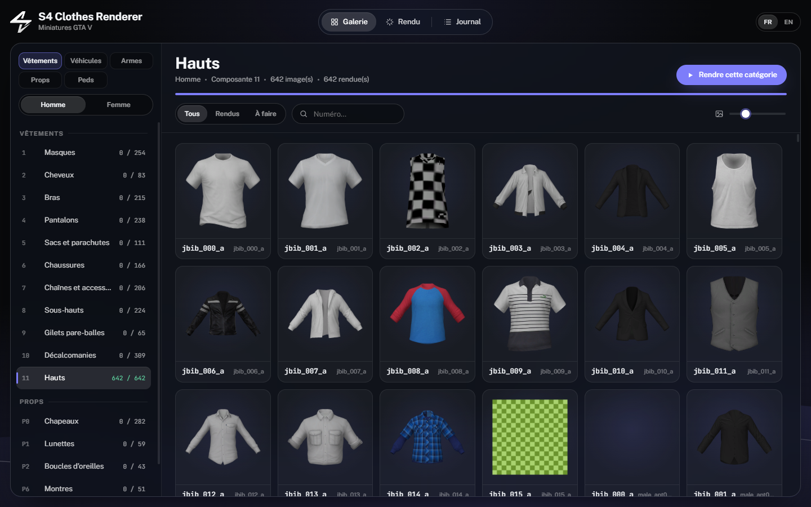

# S4 Clothes Renderer



**FR** · [EN](#english)

Génère des miniatures PNG transparentes des vêtements (freemode homme et femme), véhicules, armes, props et peds de GTA V, directement depuis les fichiers du jeu et tes dossiers addon. Pensé pour les serveurs FiveM : boutiques, menus de vestiaire, inventaires, sites web.

- Lit GTA V directement (Legacy et Enhanced) : aucune extraction à faire.
- Ajoute tes dossiers `stream` de vêtements addon : à numéro égal, le dernier dossier remplace les précédents.
- Véhicules, armes, props et peds : jeu de base, DLC et dossiers addon/FiveM (`stream`), rangés par classe, type ou lettre.
- 16 catégories de vêtements : masques, cheveux, bras, pantalons, sacs, chaussures, chaînes, sous-hauts, gilets, décalcomanies, hauts, chapeaux, lunettes, boucles d'oreilles, montres, bracelets.
- Vue adaptée à chaque catégorie, cadrage automatique, couleur de cheveux naturelle, PNG transparents de 256 à 1024 px.
- Numéros du jeu (`male/11/42.png`) grâce à la ressource `clothes_refs`, ou rangement par catégorie.
- Une couleur ou toutes les variantes de texture (`42_0.png`, `42_1.png`…).
- Galerie par catégorie, rendu en direct, reprise là où tu t'étais arrêté.
- Rendu logiciel multi-cœur : plus de 100 images par seconde sur un CPU récent.

## Installation

1. Télécharge `S4ClothesRenderer.zip` dans les [Releases](../../releases) et décompresse-le.
2. Lance `S4ClothesRenderer.exe`. GTA V est détecté automatiquement (sinon, choisis son dossier dans **Rendu › Sources**).
3. Choisis les catégories, le dossier de sortie, puis **Lancer le rendu**.

Windows 10/11 64 bits. Le runtime WebView2 (déjà présent sur Windows 11) est requis.

## Numéros du jeu (`refs.json`)

Les vêtements DLC et addon sont numérotés par collection. Pour obtenir les numéros que FiveM utilise (`SetPedComponentVariation`) :

1. Dans **Rendu › Options**, choisis **Numéros du jeu**, puis **Installer sur mon serveur** et sélectionne le dossier `resources` de ton serveur.
2. Ajoute les lignes affichées (bouton **Copier**) à ton `server.cfg` : `ensure clothes_refs` et `add_ace group.admin command.clothes_refs allow`.
3. En jeu, tape `/clothes_refs` : `refs.json` est écrit dans la ressource et importé automatiquement par le logiciel.

Refais `/clothes_refs` à chaque ajout ou retrait de vêtements sur le serveur.

## Personnalisation

Pose un `branding.json` à côté de l'exe (voir `branding.example.json`) pour changer le nom, la couleur et le logo.

## Compiler

```
git clone --recursive https://github.com/s4nare/S4ClothesRenderer
dotnet publish src/S4ClothesRenderer/S4ClothesRenderer.csproj -c Release -o publish
```

.NET SDK 10 requis.

---

## English

Generates transparent PNG thumbnails of GTA V clothing (male and female freemode), vehicles, weapons, props and peds, straight from the game files and your addon folders. Built for FiveM servers: shops, wardrobe menus, inventories, websites.

- Reads GTA V directly (Legacy and Enhanced): nothing to extract.
- Add your addon clothing `stream` folders: for the same number, the last folder wins.
- Vehicles, weapons, props and peds: base game, DLC and addon/FiveM `stream` folders, grouped by class, type or letter.
- 16 clothing categories: masks, hair, arms, pants, bags, shoes, chains, undershirts, armour, decals, tops, hats, glasses, earrings, watches, bracelets.
- Per-category camera, automatic framing, natural hair colour, transparent PNGs from 256 to 1024 px.
- Game numbers (`male/11/42.png`) through the `clothes_refs` resource, or per-category layout.
- First colour only or every texture variant (`42_0.png`, `42_1.png`…).
- Per-category gallery, live progress, resumes where you left off.
- Multi-core software renderer: over 100 images per second on a recent CPU.

### Install

1. Download `S4ClothesRenderer.zip` from [Releases](../../releases) and unzip it.
2. Run `S4ClothesRenderer.exe`. GTA V is detected automatically (otherwise pick its folder in **Render › Sources**).
3. Pick categories and the output folder, then **Start rendering**.

Windows 10/11 64-bit. The WebView2 runtime (built into Windows 11) is required.

### Game numbers (`refs.json`)

DLC and addon clothes are numbered per collection. To get the numbers FiveM uses (`SetPedComponentVariation`):

1. In **Render › Options**, choose **Game numbers**, then **Install on my server** and select your server `resources` folder.
2. Add the lines shown (**Copy** button) to your `server.cfg`: `ensure clothes_refs` and `add_ace group.admin command.clothes_refs allow`.
3. In game, type `/clothes_refs`: `refs.json` is written in the resource and imported automatically by the app.

Run `/clothes_refs` again whenever clothes are added to or removed from the server.

### Branding

Put a `branding.json` next to the exe (see `branding.example.json`) to change the name, colour and logo.

### Build

```
git clone --recursive https://github.com/s4nare/S4ClothesRenderer
dotnet publish src/S4ClothesRenderer/S4ClothesRenderer.csproj -c Release -o publish
```

Requires the .NET 10 SDK.

## Credits

- [CodeWalker](https://github.com/dexyfex/CodeWalker) by dexyfex (MIT) for reading GTA V archives and resources.
- Public Sans and JetBrains Mono fonts (SIL Open Font License).

GTA V and its assets belong to Rockstar Games. This tool only reads files from your own copy of the game.
